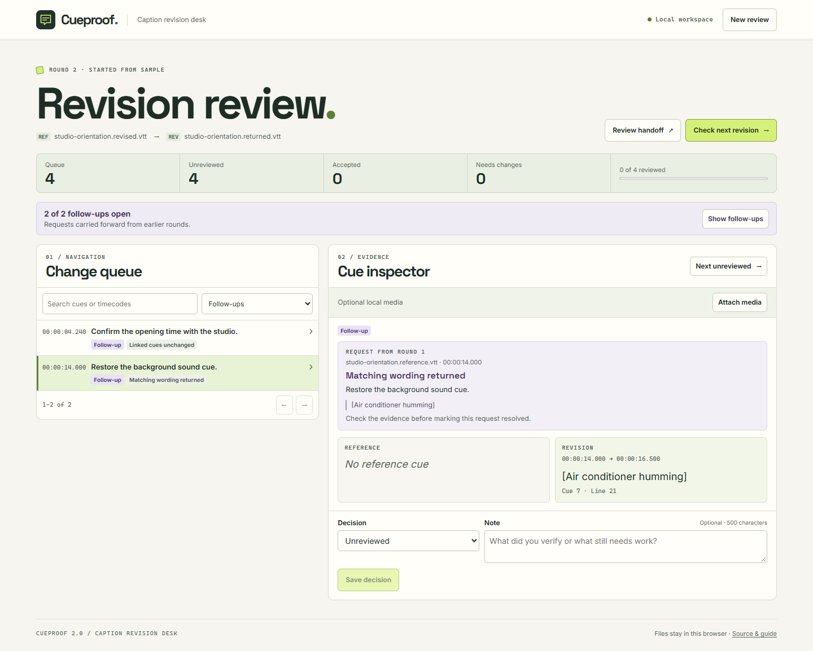

# Cueproof 2.0

A browser-based caption revision desk for video editors, accessibility reviewers, and small media teams. Compare a reference SRT or WebVTT track with a revision, check the relevant moments, and send back a timecoded review.

[Open Cueproof](https://zephyruszorro.github.io/cueproof/) · [Research](docs/research.md) · [Product design](docs/design.md) · [Version 2 design](docs/v2-plan.md) · [Verification](docs/verification.md)



## First review

1. Choose **Open sample**, or select a reference track and revised track for the same video and choose **Compare tracks**.
2. Open a row in **Change queue**. Check wording, timing, split/merge boundaries, settings, and readability advisories. Use **All cues** to inspect rows without changes.
3. Optionally **Attach media**. Switch the caption preview between the reference and revision, then use **Play cue** to listen with a little context.
4. Choose **Accepted** or **Needs changes**, add a note if useful, and **Save decision**. Use **Next unreviewed** to continue.
5. Open **Review handoff** and download a CSV for the editor or a JSON backup to keep working elsewhere.

## When the editor sends another file

1. Choose **Check next revision** and open the returned caption track for the same video and language.
2. Open **Show follow-ups**. Each request shows its original note, original evidence, and the cues the matcher found in the newest track. Requests also appear when the linked cues stayed unchanged or the match is uncertain.
3. Check the evidence against the media. Choose **Verified resolved** or **Still needs changes** and save your decision. Outstanding requests carry into the next round.
4. Download the current handoff or the previous-round backup from **Review handoff**.

To try it without files, open the sample, flag the removed `[Air conditioner humming]` cue, then choose **Check next revision → Use sample return → Start next round**.

Cueproof keeps one active review and one previous round per browser origin. Save backups to keep older rounds or to move work between browsers. V1 backups open as round one. A JSON backup includes both caption tracks, request evidence, and saved notes. Attached media stays in the current tab and is excluded from exports. **New review → Clear this workspace** clears both saved rounds.

## Run locally

Use Node.js 24 or newer and npm. From this repository:

```sh
npm ci
npm run build
npm run preview -- --port 4187 --strictPort
```

Open [http://127.0.0.1:4187/](http://127.0.0.1:4187/). No account, environment variables, server database, or media service is required. For development, run `npm run dev`. To host it elsewhere, serve the contents of `dist/` on a static HTTPS host. The GitHub Actions workflow tests the release before publishing it to Pages.

## How it works

- **Input.** UTF-8 SRT and WebVTT, with an optional BOM. Each track is limited to 2 MiB, 2,500 cues, and 8,000 code units per cue. Cue starts must be ordered. Structural errors identify the source line. The original file text stays in the review backup.
- **Comparison.** An order-preserving alignment uses timing and normalized text, with inferred shifts and two-part split/merge proposals. Cue order and exact source timings are retained. Check timing-only pairs before accepting them. Reworded splits and non-adjacent rearrangements can appear as separate rows.
- **Review.** Source line numbers, inline word differences, per-cue timing, and advisory duration, reading-speed, line-length, and overlap checks. Browser media support depends on the codec. The preview shows plain caption text, while presentation data is available as evidence in the inspector and handoff.
- **Follow-ups.** Marked requests stay open until a reviewer verifies resolution. Matching can follow a cue split or merge. A newly added or reworded cue with unique matching text near the original time can provide evidence for a missing line. Play around the request time when no cue is linked. A round can carry up to 1,500 open requests and 15,000 cue links. JSON backups retain the evidence when a CSV would exceed 32 MiB.
- **Privacy.** Parsing, comparison, and playback occur in the tab. IndexedDB stores tracks and decisions locally. The production content policy blocks network connections from the app. Browser storage can be cleared or evicted. The GitHub Pages origin can be shared with other projects under the same account, so the loopback launch provides a separate storage origin.
- **Scope.** Use the video and a human reviewer to verify accuracy, meaningful sounds, speaker labels, placement, and sync. Advisories are guides, and this release covers a subset of the caption formats.

## Open source

MIT application code. Vite and TypeScript build the static frontend. [jsdiff](https://github.com/kpdecker/jsdiff) provides the inline word diff under BSD-3-Clause. Inter and Space Grotesk ship as local fonts under OFL-1.1. The parser, alignment, review workflow, and storage are original to this project. [Third-party notices](public/third-party-notices.txt)

## Future directions

- Support manual pairing and split/merge overrides for heavily reworked tracks.
- Retain a longer review history with an explicit workspace size limit.
- Run a pilot with a school or community media team to measure missed requests and review time.
